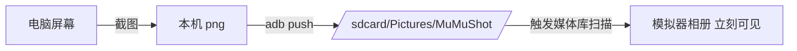

<div align="center">
  
  <h1>MuMuShot</h1>
  <p>把电脑屏幕截下来，一键送进 MuMu 模拟器的相册</p>
</div>

---

MuMu 模拟器（以及大多数安卓模拟器）都没有"从电脑取图"的能力。想给模拟器里的 App —— 微信、抖音、小红书、闲鱼 —— 发一张电脑上的截图，只能手动 `adb push` 进 `/sdcard`，还得想办法让媒体库刷新，否则相册里根本不显示。

MuMuShot 把这一串操作压缩成一个热键。



## 特性

- **4 种截图方式** —— 自绘遮罩框选、调系统截图工具、全屏、直接上传剪贴板
- **4 个全局热键** —— 不用切回面板，在任何窗口按下即截图上传
- **自动找到模拟器** —— 不写死 adb 端口，自动识别实例并连接；模拟器正在开机时会自动等待
- **自动进相册** —— 推送后触发 MediaStore 扫描，图库/微信/抖音立刻能选到这张图
- **本机留档** —— 每张截图在本机也存一份，方便回溯
- **另有 Rust 版** —— `rust/` 是功能对齐的重写，单文件免安装，启动快 2 倍（见下）

## 快速开始

### 方式一：直接下 exe（推荐）

到 [Releases](https://github.com/PandaGuGu/MuMuShot/releases) 下载 `MuMuShot.zip`，解压后双击 `MuMuShot.exe`。

> 整个文件夹要一起保留 —— 它旁边的 `_internal` 是必需的，不能只单独拷 exe。

### 方式二：从源码运行

需要 Python 3.10+（要带 tkinter）和 Pillow：

```bash
cd python
pip install pillow
python mumu_shot.py
```

## 用法

双击后会弹出一个小面板，**保持它开着**即可（关掉窗口 = 退出，热键同时失效）。

| 热键 | 作用 |
| --- | --- |
| `Ctrl + Alt + A` | 框选一块区域截图上传（自带变暗遮罩，最快） |
| `Ctrl + Alt + Q` | 调起系统截图工具框选，选完自动上传（可标注、可吸附窗口） |
| `Ctrl + Alt + S` | 全屏截图上传 |
| `Ctrl + Alt + C` | 上传剪贴板里当前的图片 |

命令行也全部支持，可以直接做快捷方式（下面命令都在 `python/` 目录下执行）：

```bash
python mumu_shot.py --full                      # 全屏截图上传
python mumu_shot.py --region                    # 交互框选
python mumu_shot.py --region 100,100,800,600    # 固定区域
python mumu_shot.py --snip                      # 调系统截图工具
python mumu_shot.py --clipboard                 # 上传剪贴板图片
python mumu_shot.py --window MuMu               # 截取指定标题的窗口
python mumu_shot.py --list-windows              # 列出所有窗口标题
python mumu_shot.py --open-gallery              # 上传后顺手在模拟器里打开
python mumu_shot.py --device 127.0.0.1:16384    # 手动指定实例（多开时用）
```

## 端口是怎么自动找到的

各家模拟器的 adb 端口并不统一（实测 MuMu 6.8.4 用的是 **16384**，而不是常见的 7555），多开时每个实例还各不相同。所以这里不硬编码，而是按准确度依次尝试：

1. **问 MuMuManager** —— `MuMuManager info -v all` 直接给出每个实例的 `adb_port` 和 Android 是否已启动（最快也最准）
2. **扫进程监听端口** —— 没有 MuMuManager 的老版本，读 `tasklist` 找出客户机进程（`MuMuNxDevice.exe`）的 PID，再从 `netstat` 拿到它实际监听的本地端口
3. **常见端口兜底** —— 7555 / 16384 / 5555 等，最后一道保险

后两步是"猜"出来的，所以加了两层保护：

- **候选先按进程身份筛**：客户机进程持有的端口全收；其它 MuMu 进程（远程服务、主控等）持有的高位数端口是自家 RPC 端口，在**调用 adb 之前**就丢掉 —— 否则每个要白等约 10 秒握手超时（实测 `adb connect` 打到这类端口耗时 10122 ms）。
- **判定加严，但不增加往返**：把「取 Android 版本号 + 探 `/sdcard/Pictures` 可用」合并进**同一次** `adb shell`，只有确实能收图的设备才被采纳；猜来的端口另用 2 秒短握手超时兜住最坏耗时。

另外，MuMuManager 报出实例但实例没启动时（此时它**不返回** `adb_port` 字段），会直接给出「模拟器没在运行」的结论，不再去猜一遍端口 —— 少了约 7 秒，报错文案也不再自相矛盾。

实测：自动识别平时只花 **0.15~0.17 秒**；模拟器没启动时 **0.53 秒**内就给出准确原因。详见 [`docs/性能评测报告.md`](docs/性能评测报告.md) §5、§7.4。

任何一步失败都会给出明确原因，而不是笼统地报"连接失败"。

## 常见问题

**首次运行弹 SmartScreen 警告？**
exe 没有代码签名，Windows 会拦一下。点「更多信息」→「仍要运行」，之后不再提示。

**上传失败去哪看原因？**
exe 同目录下的 `mumu-tool.log`（UTF-8，记事本直接打开），每次连接了哪个实例、文件的 media id 都记在里面。

**热键按了没反应？**
可能被别的软件占用了。面板底部会直接告诉你哪几个被占用，用面板按钮一样能截图。

**模拟器多开怎么办？**
自动选第一个已启动的实例。想指定具体实例用 `--device 127.0.0.1:<端口>`。

**会往模拟器里塞垃圾吗？**
只往 `/sdcard/Pictures/MuMuShot/` 一个目录写，在图库里单独成一个相簿，删起来干净。

## 项目结构

```
python/               Python 版源码
  mumu_shot.py        截图工具主程序（热键、面板、四种截图方式）
  mumu_core.py        MuMu 公共能力：adb 自动发现 / 推送 / 媒体库扫描
  mumu-shot.bat       双击即从源码启动（不用打包）
  tools/
    make_icons.py     生成图标
    rebuild_exe.py    一键重新打包成 exe（产物放回项目根目录）
    rebuild-exe.bat   Windows 下双击重新打包
    shot.ico/.png     图标
rust/                 Rust 重写版（见下）
docs/性能评测报告.md    Python 版与 Rust 版的性能对比评测
bench/                评测脚本（耗时 / 内存 / 交互验证）
MuMuShot.exe          Python 版打包产物，双击运行；旁边的 _internal 必需
```

## Rust 版

`rust/` 是同一功能的 **Rust 重写**，逐行对照 `python/mumu_shot.py` / `python/mumu_core.py` 移植：
CLI 参数、退出码、日志文案、本机留档命名全部对齐，另外补上了图形面板与全局热键。

```bash
cd rust
cargo build --release      # 产物：rust/target/release/MuMuShot.exe（单文件，免安装）
```

用法与 Python 版完全一致（`--full` / `--region` / `--snip` / `--clipboard` / `--window`
/ `--list-windows` / `--console` / `--selftest`），详见 [`rust/README.md`](rust/README.md)。

**实测对比**（同一台机器、同一个模拟器实例，n=9 取中位数）：

| 指标 | Python 版 | Rust 版 |
| --- | ---: | ---: |
| 发行体积 | 39.29 MB / 996 个文件 | **5.82 MB / 1 个文件** |
| `--selftest` 纯启动 | 279 ms | **137 ms** |
| 面板可见 | 602 ms | **45 ms** |
| `--full` 端到端上传 | 3128 ms | **2858 ms** |
| 面板常驻内存 | **35.0 MB** | 99.0 MB |

端到端只快 9%，因为耗时主要花在 adb 进程往返与模拟器媒体库索引上，与语言无关。
内存方面 Rust 反而更高（egui/OpenGL 渲染栈 + 进程内加载完整中文字体）。
完整口径、原始数据与已知局限见 [`docs/性能评测报告.md`](docs/性能评测报告.md)。

重新打包（改完代码后）：

```bash
cd python
pip install pyinstaller pillow
python tools/rebuild_exe.py     # 打好的 MuMuShot.exe 会放回项目根目录
```

程序自带一个自检入口，会检查依赖是否齐全、目录是否可写、日志能否落盘：

```bash
cd python
python mumu_shot.py --selftest
```

打 tag（`v1.0.0` 这样）推上来，GitHub Actions 会在 Windows runner 上自动构建、
跑一遍自检、通过后把 exe 打包发布到 Releases —— 自检不过就不发布。

## 环境要求

- Windows 10 / 11
- MuMu 模拟器（已在 MuMu 6.8.4 / Android 15 上实测通过；其他模拟器只要能 adb 连接，改一下识别规则也能用）

## License

[MIT](LICENSE)
